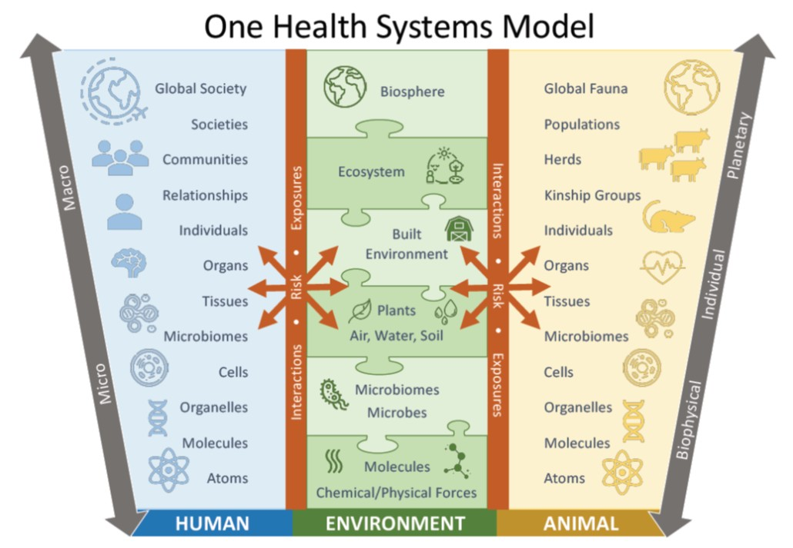
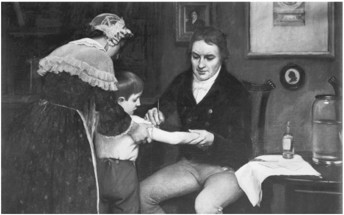
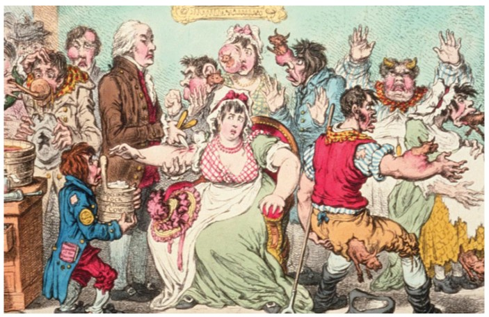
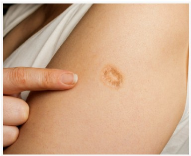

```{=html}
<style>

/* =========================================================
   Typography
   ========================================================= */

body {
  color: #212529;
}


/* =========================================================
   Responsive Mobile Layout
   Stack ALL Quarto columns on narrow screens
   ========================================================= */

@media (max-width: 768px) {

  .columns {
    display: block !important;
  }

  .columns > .column {
    width: 100% !important;
    max-width: 100% !important;
    flex: 0 0 100% !important;
  }

  .columns > .column:empty {
    display: none !important;
  }

  img {
    max-width: 100%;
    height: auto;
  }

  p,
  li,
  figcaption {
    overflow-wrap: anywhere;
  }

}


/* =========================================================
   Poll Everywhere Layout
   Keep instructions left and QR code right
   ========================================================= */

@media (min-width: 501px) {

  .poll-columns {
    display: flex !important;
    align-items: center !important;
  }

  .poll-columns > .column {
    flex: initial !important;
  }

}


/* Historical Timeline */
.history-timeline { display: flex; overflow-x: auto; gap: 0; padding: 38px 0 20px; margin: 20px 0; }
.history-event { flex: 1 0 115px; min-width: 115px; text-align: center; position: relative; border-top: 3px solid #8495a5; padding: 22px 7px 0; }
.history-event::before { content: ""; position: absolute; top: -8px; left: calc(50% - 7px); width: 14px; height: 14px; border-radius: 50%; background: #8495a5; }
.history-event.current { border-top-color: #b46c36; }
.history-event.current::before { background: #b46c36; }
.history-lecture { font-size: 0.78rem; font-weight: 700; color: #566b7d; }
.history-name { font-weight: 700; font-size: 0.92rem; margin-top: 7px; }
.history-date { font-size: 0.78rem; color: #606b74; }
.history-current-label { position: absolute; top: -39px; left: 0; right: 0; color: #a55a22; font-weight: 800; font-size: 0.82rem; }
@media print {
  .history-timeline { overflow: visible; }
  .history-event { flex: 1 1 0; min-width: 0; padding-left: 3px; padding-right: 3px; }
  .history-name { font-size: 0.72rem; }
  .history-date { font-size: 0.65rem; }
}

/* =========================================================
   Featured Question Section
   ========================================================= */

.question-highlight {
  background-color: #343a40;
  color: #ffffff;
  padding: 32px 38px;
  border-radius: 12px;
  margin: 28px 0;
  border-left: 6px solid #f4c542;
}

.question-highlight h1,
.question-highlight h2,
.question-highlight h3 {
  color: #f4c542 !important;
}

.question-highlight p,
.question-highlight p strong {
  color: #ffffff !important;
}

@media (max-width: 768px) {
  .question-highlight {
    padding: 22px 20px;
  }
}


/* =========================================================
   Smallpox Timeline
   ========================================================= */

.smallpox-timeline {
  border-left: 3px solid #8495a5;
  margin: 28px 0 28px 16px;
  padding-left: 26px;
}

.smallpox-milestone {
  position: relative;
  margin-bottom: 23px;
}

.smallpox-milestone::before {
  content: "";
  position: absolute;
  left: -35px;
  top: 5px;
  width: 13px;
  height: 13px;
  border-radius: 50%;
  background: #8495a5;
  border: 3px solid white;
}

.smallpox-century {
  font-weight: 800;
  color: #9a552b;
  margin-bottom: 5px;
}

.smallpox-description {
  color: #212529;
  line-height: 1.55;
}

@media (max-width: 768px) {
  .smallpox-timeline {
    margin-left: 9px;
    padding-left: 20px;
  }

  .smallpox-milestone::before {
    left: -29px;
  }
}


/* =========================================================
   Align Historical Section Headings with Images
   ========================================================= */

.ancient-egypt-layout {
  align-items: flex-start !important;
}

.ancient-egypt-layout .history-text-column h3:first-of-type {
  margin-top: 0 !important;
  margin-block-start: 0 !important;
  padding-top: 0 !important;
}

.ancient-egypt-layout .history-text-column {
  padding-top: 0 !important;
}


/* Equal-height cowpox images */

img.cowpox-equal-height {
  width: 100%;
  height: 280px;
  object-fit: contain;
}


</style>
```

:::::: columns
::: {.column width="40%"}
{fig-alt="Great Sphinx of Giza in Egypt, with a pyramid visible in the background" width="100%"}
:::

::: {.column width="4%"}
:::

::: {.column width="56%"}
## SHM 102: Occupational Health

### Public Health History: Vaccination

**Lecture 04 · Fall 2026**

Yoni Rodriguez\
Engineering Technologies, Safety, and Construction\
Central Washington University\
[Yoni.Rodriguez\@cwu.edu](mailto:Yoni.Rodriguez@cwu.edu)
:::
::::::

------------------------------------------------------------------------

# Where Are We in Time?

Last class, we followed plague across more than **500 years** of scientific discovery.

Today, we are going to **rewind**.

Before we get started, let's place ourselves back into the larger history of human health.

------------------------------------------------------------------------

## From Human History to Microbiology

Our lectures have moved across thousands of years of human history.

**Where have we been, and where are we today?**

```{=html}
<div class="history-timeline">

  <div class="history-event">
    <div class="history-lecture">Lecture 02</div>
    <div class="history-name">Paleolithic Era</div>
    <div class="history-date">Prehistory · Before ~10,000 BCE</div>
  </div>

  <div class="history-event">
    <div class="history-lecture">Lecture 02</div>
    <div class="history-name">Agricultural Revolution</div>
    <div class="history-date">Neolithic · ~10,000 BCE</div>
  </div>

  <div class="history-event">
    <div class="history-lecture">Lecture 03</div>
    <div class="history-name">Black Death</div>
    <div class="history-date">14th Century · 1347–1351</div>
  </div>

  <div class="history-event">
    <div class="history-lecture">Lecture 03</div>
    <div class="history-name">Microscopy</div>
    <div class="history-date">17th Century · 1676</div>
  </div>

  <div class="history-event current">
    <div class="history-current-label">↓ WE ARE HERE</div>
    <div class="history-lecture">Lecture 04</div>
    <div class="history-name">Vaccination</div>
    <div class="history-date">18th–19th Century · 1700s–1800s</div>
  </div>

  <div class="history-event">
    <div class="history-lecture">Lecture 01</div>
    <div class="history-name">Modern Occupational Health</div>
    <div class="history-date">21st Century · 2020–2026</div>
  </div>

</div>
```

::: {.callout-note title="Today's Historical Focus"}
We are returning to the eighteenth century.

**How did people learn to prevent disease before they understood its biological cause?**
:::

------------------------------------------------------------------------

::: {.callout-note title="Today's Window: 1717–1835"}
Between the first observations of microorganisms and the establishment of germ theory, people were already learning how to **prevent disease** and **experimentally investigate its causes**.

Today we are zooming in on two developments:

1.  **Smallpox prevention → variolation and vaccination**
2.  **Microbial causation → Bassi and silkworm disease**
:::

------------------------------------------------------------------------

::: question-highlight
# A Question From Class

Earlier in the 2026 fall quarter, while discussing infectious disease and the development of germ theory, someone asked about **when were vaccines developed and who developed them?**

These questions dive into interesting public health and occupational health history

Edward Jenner conducted his famous vaccination experiment in **1796**.

But how did he get the idea to vaccinate someone?
:::

------------------------------------------------------------------------

## Poll Everywhere

::::::: {.columns .poll-columns}
::: {.column width="65%"}
### What Would You Look For?

Imagine it is **1796**.

You do not know what a virus is.

You do not know what antibodies are.

You do not know how the immune system works.

**What observations could convince you that someone might be protected from a disease?**

There is no single correct answer.

Think about what you could observe in individuals and populations.
:::

::: {.column width="5%"}
:::

:::: {.column width="30%"}
::: {style="display:flex; justify-content:center; align-items:center; height:100%;"}
{fig-alt="Poll Everywhere QR code and response link for SHM 102" width="250"}
:::
::::
:::::::

------------------------------------------------------------------------

# Smallpox

:::::: columns
::: {.column width="48%"}
: World Health Organization, Smallpox Recognition Card; reproduced from *Smallpox and Its Eradication* (1988).](who-smallpox-face-1988.jpg){fig-alt="Historical WHO clinical photograph showing smallpox lesions on a child's face" width="100%"}
:::

::: {.column width="4%"}
:::

::: {.column width="48%"}
: World Health Organization, Smallpox Recognition Card; reproduced from *Smallpox and Its Eradication* (1988).](who-smallpox-body-1988.jpg){fig-alt="Historical WHO clinical photographs showing widespread smallpox lesions on a child's body and close-up views of lesions on the extremities" width="100%"}
:::
::::::

Smallpox was a highly contagious infectious disease that affected human populations for thousands of years.

People could observe:

- fever
- head and body aches
- early rash
- pustular rash and scabs
- death (often within two weeks)
- outbreaks moving through communities

::: {.callout-note title="An Important Observation"}
They could observe the **outcome**.

But there was another important observation.

### People who survived smallpox generally did not develop the disease again.

Something about surviving the disease appeared to change a person's **susceptibility**.
:::

------------------------------------------------------------------------

## How Far Back Does Smallpox Go?

The origin of smallpox remains unknown.

However, historical and archaeological evidence suggests that diseases resembling smallpox affected human populations thousands of years ago.

::::::: {.columns .ancient-egypt-layout}
:::: {.column .history-text-column width="54%"}
### Ancient Egypt

The approximately **3,000-year-old mummy of Pharaoh Ramses V** has skin lesions that have been interpreted as resembling smallpox pustules.

This suggests that smallpox, or a disease with similar characteristics, may have existed in ancient Egypt.

However, the appearance of skin lesions alone cannot establish a definitive diagnosis.

::: callout-important
**The earliest origins of smallpox remain uncertain.**
:::
::::

::: {.column width="4%"}
:::

::: {.column width="42%"}
: CDC, History of Smallpox. Original image credited to G. Elliot Smith, public domain.](pharoah-ramses-v-smallpox.jpg){fig-alt="Profile view of the mummified head of Pharaoh Ramses V showing visible skin changes" width="100%"}
:::
:::::::

### [Historical Events by Century](https://www.cdc.gov/smallpox/about/history.html)

: CDC, The Spread and Eradication of Smallpox.](smallpox-historical-map.jpg){#fig-smallpox-map fig-alt="Illustrated world map showing historical evidence of smallpox by century, with a chronological color legend, geographic markers, and no transmission arrows" width="100%"}

## From Smallpox to Deliberate Inoculation

During the eighteenth century, **smallpox** infected a large fraction of the European population, killing or disfiguring many people.

Although the existence of the virus responsible for smallpox was unknown, people in countries of **Asia and Africa** were already practicing the **deliberate inoculation of children with material from smallpox pustules**.

Inoculated children usually developed a mild case of the disease and were protected from smallpox thereafter.

### What Was Variolation?

The historical practice of deliberate smallpox inoculation was known as **variolation**, named after *variola*, another name for smallpox.

Variolation was practiced in parts of Asia and Africa long before the development of vaccination.

### [How Was Variolation Performed?](https://www.who.int/news-room/spotlight/history-of-vaccination/history-of-smallpox-vaccination)

Historical methods differed across regions. In **China**, written accounts from the mid-1500s describe **insufflation**, in which dried smallpox scabs were ground into powder and blown into the nostril using a pipe. In **India**, historical accounts describe using a **lancet or needle** to introduce material from smallpox pustules into the skin of healthy children.

Both methods sought to produce protection against future smallpox disease.

: CDC, *Emerging Infectious Diseases*.](chinese-nasal-insufflation.jpg){#fig-chinese-insufflation width="100%" fig-align="center" lightbox="true"}

: Google Arts & Culture, *Early Chinese/Indian Inoculation (Variolation)*.](variolation.jpg){#fig-early-variolation width="85%" fig-align="center" lightbox="true"}

------------------------------------------------------------------------

## How Did Variolation Reach Britain and Colonial America?


### [Lady Mary Wortley Montagu](https://cyh.rrchnm.org/primary-sources/157.html)

In **1717**, **Lady Mary Wortley Montagu**, a British aristocrat and smallpox survivor traveling in the **Ottoman Empire**, learned of *engrafting*, a local practice of variolation that deliberately introduced smallpox material by using a **large needle** to make small openings in the skin and insert material collected from smallpox sores.

The practitioner would ask, *"What vein you please to have opened?"* During a period outside the host, the virus becomes *"attenuated"*; that is, it loses some of its molecular structure required for infection. The attenuated form of the virus stimulates the immune system with much lower mortality than the fully virulent virus.

In **1718**, she arranged for her son to undergo the procedure.

Montagu was impressed by the practice, became an advocate for variolation, and introduced it to British society.

**Montagu did not invent variolation. She helped bring an established preventive practice to the attention of British society.**

::::: columns
::: {.column width="40%"}
: Wikimedia Commons.](jean-baptise-vanmour-oil-painting-lady-montagu-with-son.jpg){#fig-lady-mary-montagu width="100%" fig-align="center" lightbox="true"}
:::

::: {.column width="60%"}
: TheCollector.](ottoman-empire.jpg){#fig-ottoman-empire width="100%" fig-align="center" lightbox="true"}
:::
:::::


### Onesimus and Colonial Boston

Knowledge of variolation also reached colonial North America through **Onesimus**, an enslaved African man who described the practice to **Cotton Mather**, a Boston minister.

Onesimus explained that the procedure was already practiced in Africa, providing Mather with knowledge of a method of smallpox prevention.

During the **1721 Boston smallpox epidemic**, Mather promoted variolation as a means of reducing the danger of the disease.

These histories demonstrate that **knowledge of disease prevention existed across different communities long before it became widely accepted in European and colonial American medicine**.

::::: columns
::: {.column width="40%"}
: Brooklyn Nets, NBA (2019).](onesimus.jpg){#fig-onesimus width="100%" fig-align="center" lightbox="true"}
:::

::: {.column width="60%"}
: Forbes, Kiona N. Smith (2021).](boston-1722.jpg){#fig-boston-1722 width="100%" fig-align="center" lightbox="true"}
:::
:::::


## [The Risks of Variolation](https://pmc.ncbi.nlm.nih.gov/articles/PMC1200696/)

Variolation could reduce the risk of dying from smallpox, but it was still dangerous because inefected individuals still contracted serious disease and were contagious. 

Historical reports from the **1721 Boston epidemic** suggested lower mortality among variolated individuals than among those who acquired smallpox naturally.

Still, doctros conintued to seek a better method of prevention. 


------------------------------------------------------------------------

## Poll Everywhere

::::::: {.columns .poll-columns}
::: {.column width="65%"}
### Historical Perspectives on Smallpox Inoculation

Before today's lecture, were you aware that **smallpox inoculation (variolation)** was practiced in parts of Asia and Africa long before the development of modern vaccination?

**If you had lived during the eighteenth century, would you have considered undergoing smallpox inoculation? Why or why not?**
:::

::: {.column width="5%"}
:::

:::: {.column width="30%"}
::: {style="display:flex; justify-content:center; align-items:center; height:100%;"}
{fig-alt="Poll Everywhere QR code and response link for SHM 102" width="250"}
:::
::::
:::::::


------------------------------------------------------------------------

# An Observation From the Countryside

## Cowpox

In England, milkmaids claimed that they were protected from smallpox after they contracted **cowpox**.

Cowpox is caused by a virus belonging to the **Orthopoxvirus** genus, the same genus as the virus responsible for smallpox. However, *cowpox* generally causes a much milder illness compared to smallpox.

::::: {.columns}
::: {.column width="50%"}
: Robert Harding Picture Library.](cowpox-virus.jpg){#fig-cowpox-virus .cowpox-equal-height width="100%" fig-align="center" lightbox="true"}
:::

::: {.column width="50%"}
: CDC, *Emerging Infectious Diseases*.](cowpox-lesions-forearm-day-7-after-onset.jpg){#fig-cowpox-lesions .cowpox-equal-height width="100%" fig-align="center" lightbox="true"}
:::
:::::

### People who had experienced cowpox appeared less likely to develop smallpox.


------------------------------------------------------------------------

## Look at the Occupation

Who would have repeated opportunities to encounter cowpox?

**People working with cattle.**

Especially:

**milkmaids.**

The occupation created an **opportunity for exposure**. Remember what we learned from the plague investigation:

**The occupational hazard is not determined by the job title alone.** 

It depends on the **task and opportunity for exposure**.

::::: {.columns}
::: {.column width="50%"}
: Centers for Disease Control and Prevention.](cowpox-transmission.jpg){#fig-cowpox-transmission .cowpox-equal-height width="100%" fig-align="center" lightbox="true"}
:::

::: {.column width="50%"}
{#fig-one-health-systems-model .cowpox-equal-height width="100%" fig-align="center" lightbox="true"}
:::
:::::

### Occupational exposure connects human health, animal health, and the environment.

------------------------------------------------------------------------


# Edward Jenner

:::::: {.columns}
::: {.column width="60%"}
English physician **Edward Jenner (1749–1823)** practiced medicine in the English countryside, where he became interested in the relationship between **cowpox and smallpox**.

He had heard the observation that **milkmaids and others who had previously contracted cowpox** seemed protected against smallpox.

This observation suggested that exposure to one infectious disease might provide protection against another.

But remember what we learned from lecture 03:

### An observation is not necessarily proof.

Jenner needed a way to test the hypothesis.
:::

::: {.column width="4%"}
:::

::: {.column width="36%"}
: MyLearning.](edward-jenner.jpg){#fig-edward-jenner width="100%" fig-align="center" lightbox="true"}
:::
::::::


------------------------------------------------------------------------

# The Hypothesis

::::::: {.columns}
::: {.column width="30%"}
## Observation

People exposed to cowpox sometimes appeared resistant to smallpox.
:::

::: {.column width="5%"}
<div style="text-align:center; font-size:2rem; padding-top:65px;">
→
</div>
:::

::: {.column width="30%"}
## Question

Does infection with cowpox protect against smallpox?
:::

::: {.column width="5%"}
<div style="text-align:center; font-size:2rem; padding-top:65px;">
→
</div>
:::

::: {.column width="30%"}
## Hypothesis

Previous exposure to cowpox provides protection against smallpox.
:::
:::::::


------------------------------------------------------------------------

# Testing the Hypothesis

:::::: columns
::: {.column width="60%"}
In **1796**, Jenner obtained material from a cowpox lesion on the hand of **Sarah Nelmes**, a milkmaid who had contracted cowpox.

He inoculated **James Phipps**, an eight-year-old boy, with the material.

Phipps developed symptoms consistent with cowpox and recovered.

Rather than waiting to see whether Phipps would naturally encounter smallpox, Jenner deliberately exposed him to material from smallpox to test whether the previous cowpox infection had provided protection.

### Phipps did not develop smallpox.

Jenner subsequently conducted additional observations and experiments and published his findings in **1798**.
:::

::: {.column width="4%"}
:::

::: {.column width="36%"}
{#fig-jenner-james-phipps width="100%" fig-align="center" lightbox="true"}
:::
::::::

------------------------------------------------------------------------

::: {.callout-important title="Historical Evidence and Modern Ethics"}
Jenner's experiment became historically important in the development of vaccination.

**It would not meet modern standards for ethical human-subjects research.**

Deliberately exposing a child to potentially lethal smallpox would be unacceptable under contemporary research ethics.

Scientific importance does not mean that every historical research method should be accepted by modern standards.
:::

## ------------------------------------------------------------------------

## Where Did "Vaccination" Come From?

The word **vaccination** traces to the Latin:

### *vacca* = cow

Jenner used the term *variolae vaccinae* in describing cowpox.

Eventually, **vaccination** became the broader term for inducing protection against infectious disease.

**Historical source:** Riedel S. *Edward Jenner and the history of smallpox and vaccination.* Proc (Bayl Univ Med Cent). 2005;18(1):21–25. [PMCID: PMC1200696](https://pmc.ncbi.nlm.nih.gov/articles/PMC1200696/).

------------------------------------------------------------------------

# Variolation vs. Vaccination

|   | **Variolation** | **Vaccination** |
|------------------------|------------------------|------------------------|
| **Exposure** | Smallpox material | Historically, cowpox material |
| **Goal** | Produce protection against smallpox | Produce protection against smallpox |
| **Smallpox exposure** | Yes | No |
| **Relative danger** | Greater | Lower |

------------------------------------------------------------------------

# A New Intervention Creates a New Concern

Vaccination addressed one of the central hazards of variolation:

### People no longer had to be deliberately exposed to smallpox itself.

But a new intervention created another question.

# Would people trust it?

People were being asked to accept something unfamiliar:

**material associated with a disease of cows** → **introduced into a human** → **to protect against smallpox.**

At the time, people did not understand:

- viruses
- antigens
- antibodies
- B cells
- T cells
- immune memory

They could observe whether vaccination appeared to protect people.

### They could not yet explain the mechanism.

------------------------------------------------------------------------

# Public Reaction to Vaccination

{#fig-vaccination-cartoon width="75%" fig-align="center" lightbox="true"}

### What do you notice?

Before interpreting the image, look closely at:

- the people receiving the intervention
- the physician
- what appears to be happening to vaccinated people

### What argument is the artist making?

------------------------------------------------------------------------

## Poll Everywhere

::::::: {.columns .poll-columns}
::: {.column width="65%"}
### Why Might People Be Skeptical?

Vaccination was a new preventive intervention.

**What might make an unfamiliar health intervention difficult for people to trust?**

Think about:

- unfamiliar technology
- uncertainty
- perceived risk
- inability to observe the mechanism directly
- trust in the people recommending the intervention
- competing information and beliefs
:::

::: {.column width="5%"}
:::

:::: {.column width="30%"}
::: {style="display:flex; justify-content:center; align-items:center; height:100%;"}
{fig-alt="Poll Everywhere QR code and response link for SHM 102" width="250"}
:::
::::
:::::::

------------------------------------------------------------------------

# Vaccination Skepticism Is Not New

The cartoon exaggerated fears surrounding the new practice of vaccination.

People are depicted developing **cow-like features** after receiving cowpox material.

The biological claim was false.

But the image reveals something important about the history of public health:

### A preventive intervention can be effective and still encounter public skepticism.

Questions surrounding a new intervention may include:

- Is it safe?
- Does it actually work?
- What exactly is being put into the body?
- What unintended effects might occur?
- Can the people promoting it be trusted?

Jenner's work did not produce immediate universal acceptance. His early work encountered skepticism, criticism, and ridicule even as vaccination spread.

::: {.callout-note title="Evidence and Trust"}
Public health requires more than developing an intervention.

It also requires **producing evidence, communicating uncertainty, explaining risk, and building trust**.
:::

**Historical source:** Riedel S. *Edward Jenner and the history of smallpox and vaccination.* Proc (Bayl Univ Med Cent). 2005;18(1):21–25. PMCID: PMC1200696.


------------------------------------------------------------------------

# But How Did Jenner's Cowpox Vaccination Work?

Jenner's **1796 experiment** used material from a cowpox lesion. 

His vaccine was **not** the standardized vaccinia-based vaccines that would later be used to eradicate smallpox.

Jenner could observe protection, but he could not explain it using modern immunology. He did not know about **viruses**, **antigens**, **antibodies**, **B cells**, **T cells**, or **immune memory**.

## Antigens and Antibodies

To understand how vaccination works, we need to understand two important terms:

**Antigen:** A substance or part of a microorganism, such as a virus or bacterium, that the immune system recognizes as foreign and may respond to.

**Antibody:** A protective protein produced by the immune system that recognizes and attaches to a specific antigen, helping the body fight infection.

In simple terms:

*Antigen = Something foreign that the immune system recognizes.*

*Antibody = Something the body produces to help protect against that foreign material.*


{#fig-immunology-interferons width="85%" fig-align="center" lightbox="true"}

The body also produces proteins called **interferons**, which help cells defend themselves against viruses.

For example:

- When a virus infects a cell, that cell can release interferons that help nearby cells resist infection.
- Certain immune cells can also produce interferons that help coordinate the body's defenses.

::: {.callout-note title="Remember These Three Terms"}

**Antigen:** Something the immune system recognizes as foreign.

**Antibody:** A protein produced by the body that attaches to a specific antigen and helps defend against infection.

**Interferon:** A protein that helps cells defend against viruses and coordinates immune responses.

**Antigens are recognized → Antibodies help fight infection → Interferons help cells resist viruses**

:::

## Connecting These Concepts to Jenner's Experiment

Today, we understand that cowpox and smallpox viruses have some similar antigens.

When Jenner introduced cowpox-associated material into the body, the immune system could recognize those antigens and develop protection.

Because cowpox and smallpox viruses share certain features, the immune response to cowpox could also help protect against smallpox.

This is called **cross-protective immunity**.

**Exposure to cowpox-associated antigens → Immune response → Immune memory → Protection against later smallpox exposure**

### Jenner observed this protection long before scientists understood how the immune system worked.

**Cowpox-associated inoculation (Jenner) → Development and standardization of vaccinia-based vaccines → Global eradication campaign**

: ResearchGate, *The Poxviridae Genera of the Chordopoxvirinae of Medical Interest*.](orthopoxvirus-genus.jpg){#fig-orthopoxvirus-genus width="85%" fig-align="center" lightbox="true"}

Members of the *Orthopoxvirus* genus share certain antigens because they are closely related viruses.

### Vaccination helps prepare the immune system before exposure to a dangerous disease.

**Sources:**

- Male, D., Brostoff, J., Roth, D. B., & Roitt, I. *Immunology* (7th ed.). Mosby Elsevier.
- [American Association of Immunologists — Antibodies and Antigens](https://immunologyexplained.aai.org/what-is-immunology/antibody-and-antigen/)
- [Cleveland Clinic — Antibodies](https://my.clevelandclinic.org/health/body/22971-antibodies)


------------------------------------------------------------------------

## What Was Actually in the Smallpox Vaccine?

::::: {.columns}

::: {.column width="65%"}

The traditional smallpox vaccine contained **live, replication-competent vaccinia virus**.

It was **not** a weakened preparation of variola virus, the pathogen responsible for smallpox.

Because vaccinia could replicate at the vaccination site, it typically produced a localized lesion that could leave a characteristic vaccination scar.

Modern smallpox vaccines differ in whether the vaccine virus can replicate productively in human cells.

:::

::: {.column width="35%"}

{#fig-smallpox-vaccine-scar width="100%" fig-align="center" lightbox="true"}

:::

:::::

| Vaccine | Virus or strain | Replication in human cells |
|---|---|---|
| Traditional eradication-era vaccines | Live vaccinia | Replication-competent |
| **ACAM2000** | Live vaccinia | Replication-competent |
| **JYNNEOS** | Modified vaccinia Ankara (MVA-BN) | Does not replicate productively |

**Important distinction:** JYNNEOS uses an attenuated vaccinia strain, whereas ACAM2000 contains replication-competent vaccinia.

These differences matter for **vaccine safety**, particularly when considering certain medical conditions and the possibility of contact exposure to vaccine virus from a replication-competent vaccination site.

### None of these vaccines contains variola virus.

[Source: CDC — Smallpox Vaccines for Healthcare Professionals](https://www.cdc.gov/smallpox/hcp/vaccines/index.html)

------------------------------------------------------------------------


## Vaccination and the Prevention of Disease

Vaccines have two important potential effects.

**First: Individual protection**

Vaccination can reduce a person's likelihood of infection, serious disease, or other adverse outcomes, depending on the vaccine and pathogen.

**Second: Population protection**

When vaccination substantially reduces transmission, immunity across a population can help protect people who remain susceptible.

This population-level effect is often called **herd immunity** or **community immunity**.

However, herd immunity does not occur equally with every vaccine or infectious disease. It depends on factors such as transmissibility, vaccine effectiveness against infection and transmission, and the distribution of immunity.

For smallpox, vaccination was central to the worldwide eradication campaign.

## Why Does This Matter for Occupational Health?

Consider a healthcare worker who may encounter an infectious patient.

The worker's occupation creates opportunities for exposure, but exposure does not necessarily result in infection or disease.

Vaccination can change the worker's susceptibility or the consequences of exposure.

However, vaccination does not eliminate the need for other protective measures.

**Vaccination is one component of occupational biological hazard prevention—not a replacement for exposure controls.**

::: {.callout-important title="Think Like an Occupational Health Professional"}

When evaluating vaccination as a protective intervention, ask:

1. What biological hazard may be present?
2. Which occupational tasks create opportunities for exposure?
3. What immune protection can vaccination provide?
4. Does the vaccine prevent infection, reduce disease severity, reduce transmission, or some combination?
5. What additional controls remain necessary?

:::

## Scientific Sources

- Male, D., Brostoff, J., Roth, D. B., & Roitt, I. *Immunology* (7th ed.). Mosby Elsevier. Chapter 2, Fig. 2.2; Chapter 8, Figs. 8.5 and 8.16; Chapter 18, "Vaccination," pp. 325–326.
- [CDC — Smallpox Vaccines](https://www.cdc.gov/smallpox/vaccines/index.html)
- [CDC — Smallpox Vaccines for Healthcare Professionals](https://www.cdc.gov/smallpox/hcp/vaccines/index.html)


------------------------------------------------------------------------

# From Vaccination to Global Eradication

Smallpox eradication required more than a vaccine. It depended on **surveillance**, recognizing cases, tracing contacts, and responding rapidly to outbreaks.

The World Health Organization began a global eradication program in **1959** and intensified the campaign in **1967**.

: Centers for Disease Control and Prevention.](global-smallpox-eradication.jpg){#fig-global-smallpox-eradication width="100%" fig-align="center" lightbox="true"}

## Milestones

| Year     | Milestone                                             |
|----------|-------------------------------------------------------|
| **1959** | WHO launches a global smallpox eradication program.   |
| **1967** | Intensified eradication program begins.               |
| **1977** | Last naturally acquired case of smallpox, in Somalia. |
| **1980** | World Health Assembly declares smallpox eradicated.   |

### Vaccination + surveillance + rapid intervention = global prevention.

[Source: CDC — History of Smallpox](https://www.cdc.gov/smallpox/about/history.html)


------------------------------------------------------------------------

## The Last Naturally Acquired Case: Ali Maow Maalin

::::: {.columns}

::: {.column width="65%"}

In **1977**, Ali Maow Maalin, a hospital cook in Somalia who also assisted with transporting patients, developed smallpox.

His case demonstrates that biological exposure may occur through **specific tasks**, even when a worker's job title does not suggest direct clinical care.

Public health teams investigated contacts and worked to prevent further transmission.

*Historical discussion: This Podcast Will Kill You, Episode 3, “Smallpox”; compare with the [CDC history](https://www.cdc.gov/smallpox/about/history.html).*

:::

::: {.column width="35%"}

: Centers for Disease Control and Prevention, Public Health Image Library (PHIL), Image ID 7083.](ali-maow-maalin.jpg){#fig-ali-maow-maalin width="60%" fig-align="center" lightbox="true"}

:::

:::::


------------------------------------------------------------------------

# Eradicated, but Not Forgotten

Smallpox no longer circulates naturally in human populations. Nevertheless, **biosafety**, **biosecurity**, and **emergency preparedness** remain relevant.

WHO-authorized stocks of variola virus are held at two designated facilities:

- **CDC**, Atlanta, United States.
- **VECTOR**, Koltsovo, Russia.

## Smallpox and Bioterrorism

The possibility of an intentional release is one reason smallpox remains part of public health preparedness discussions.

**Bioterrorism:** The deliberate use of a biological agent to cause illness or harm.

A deliberate release of variola virus is a **potential biosecurity threat**, not evidence of a current smallpox outbreak.

Although smallpox has been eradicated, public health agencies continue to maintain plans for recognizing suspected cases, protecting exposed individuals, and responding to potential emergencies.

## Why Does This Matter for Occupational Health?

In a suspected smallpox event, occupational health professionals may need to consider:

- **Healthcare worker protection:** Recognizing possible cases and preventing occupational exposure.
- **Safe specimen handling:** Ensuring that biological specimens are collected and handled by authorized personnel using appropriate precautions.
- **Exposure assessment:** Identifying potentially exposed workers and conducting contact tracing.
- **Public health response:** Coordinating isolation, vaccination decisions, and other protective measures with public health authorities.

These responsibilities demonstrate how occupational health professionals contribute to protecting workers during biological emergencies.

### Eradication eliminated natural transmission, not the need for preparedness.

**Sources:**

- [CDC — History of Smallpox](https://www.cdc.gov/smallpox/about/history.html)
- [CDC — Smallpox](https://www.cdc.gov/smallpox/index.html)


------------------------------------------------------------------------

## Janet Parker: An Occupational Health Case Study

::::: {.columns}

::: {.column width="65%"}

In **1978**, **Janet Parker**, a medical photographer at the University of Birmingham in England, contracted smallpox while working in a building that housed a smallpox laboratory.

She died from the infection. Her case is recognized as the last fatal case of smallpox.

**The exact route of exposure was not conclusively established.** It should not be presented as a proven ventilation-system failure.

### A worker can face biological risk without directly conducting pathogen research.

**Think back to the plague investigation:** What would an occupational exposure assessment examine in this building?

*Historical discussion: This Podcast Will Kill You, Episode 3, “Smallpox”; see also [CDC — History of Smallpox](https://www.cdc.gov/smallpox/about/history.html).*

:::

::: {.column width="35%"}


: *Birmingham Mail*.](janet-parker.jpg){#fig-janet-parker width="100%" fig-align="center" lightbox="true"}


:::

:::::

------------------------------------------------------------------------


# How Are Vaccines Developed Today?

Jenner's 1796 experiment provided an early demonstration of vaccination, but it did not follow modern clinical research standards.

Today, vaccine development involves **laboratory research**, **preclinical studies**, **clinical trials**, **regulatory evaluation**, **manufacturing quality controls**, and **safety monitoring after authorization**.

| Stage | Central question |
|------------------------------------|------------------------------------|
| Preclinical research | What immune response does the candidate generate, and what safety concerns appear? |
| Phase 1 clinical trials | What initial safety and immune-response findings appear in a small group of participants? |
| Phase 2 clinical trials | What doses and immune responses are observed in a larger group? |
| Phase 3 clinical trials | How well does the vaccine prevent its intended outcomes, and what safety findings emerge in a larger population? |
| Regulatory review and manufacturing | Does the evidence support authorization, and can the product be manufactured consistently? |
| Post-authorization monitoring | What additional safety and effectiveness information emerges during wider use? |

### Developing a vaccine means evaluating both the intervention and the evidence supporting it.


------------------------------------------------------------------------

## Does Vaccine Development Always Take Decades?

::::: {.columns}

::: {.column width="65%"}

A common claim is that **every vaccine must take decades to develop**.

That statement confuses the time required to build a scientific foundation with the timeline of a particular vaccine's clinical development and evaluation.

Consider **polio**:

- **Jonas Salk** developed an **inactivated poliovirus vaccine (IPV)**, which was evaluated in a major 1954 field trial and announced as effective in 1955.
- **Albert Sabin** developed a **live, attenuated oral poliovirus vaccine (OPV)** that became widely used later.
- Both vaccines built on earlier discoveries about poliovirus, immunity, and methods of growing the virus.

The **1955 Cutter incident**, in which improperly inactivated vaccine caused cases of polio, also illustrates why manufacturing quality and independent oversight are essential.

:::

::: {.column width="35%"}

: Global Polio Eradication Initiative, *History of Polio*.](polio.jpg){#fig-polio-history width="100%" fig-align="center" lightbox="true"}

:::

:::::

### [The appropriate question is not simply "How many years did it take?" but "What evidence demonstrates safety, effectiveness, and manufacturing quality?"]{style="color: #C62828;"}

------------------------------------------------------------------------


# Key Takeaways

1.  **Occupational observations can lead to public health discoveries.** Jenner's investigation began with reports of cowpox among people working with cattle, especially milkmaids.
2.  **Variolation and vaccination were different interventions.** Variolation exposed people to smallpox material; Jenner's vaccination used cowpox-associated material.
3.  **Jenner's original preparation and later eradication-era vaccines were not identical.** The latter used vaccinia virus, not variola virus.
4.  **Cross-protective immunity explains the biological connection.** Shared orthopoxvirus antigens can stimulate adaptive immune responses and immune memory.
5.  **Eradication required more than vaccination.** Surveillance, case identification, contact tracing, and rapid public health response were essential.
6.  **Job titles do not define biological exposure.** The cases of Ali Maow Maalin and Janet Parker demonstrate the importance of examining workers' actual tasks and environments.
7.  **Eradication does not eliminate preparedness responsibilities.** Biosafety, biosecurity, and emergency planning remain relevant.
8.  **Modern vaccine development evaluates evidence at multiple stages.** Clinical trials, manufacturing controls, and post-authorization monitoring matter more than an arbitrary number of years.

------------------------------------------------------------------------

# Key Terms and Definitions

| Term | Definition |
|------------------------------------|------------------------------------|
| **Smallpox** | Eradicated human infectious disease caused by variola virus. |
| **Variola virus** | The orthopoxvirus that causes smallpox. |
| **Cowpox** | Disease associated with an orthopoxvirus that informed Jenner's original vaccination experiment. |
| **Vaccinia virus** | Related orthopoxvirus used in traditional smallpox vaccines and eradication campaigns. |
| **Variolation** | Historical practice of deliberately exposing someone to smallpox material to induce protection. |
| **Vaccination** | Intervention intended to stimulate protective immunity; its name derives from Latin *vacca*, meaning cow. |
| **Antigen** | Molecular feature recognized by the immune system. |
| **Adaptive immunity** | Antigen-specific immune response involving B cells and T cells. |
| **Antibody** | Protein produced by B cells that binds a specific antigen. |
| **Immune memory** | Ability of the adaptive immune system to respond more effectively after prior antigen exposure. |
| **Cross-protective immunity** | Immune protection against a pathogen arising from exposure to a related pathogen or its antigens. |
| **Live, replication-competent vaccine** | Vaccine containing a live organism capable of productive replication in the recipient. |
| **Live, attenuated vaccine** | Vaccine containing a weakened live organism; attenuation and replication competence are distinct properties. |
| **Surveillance** | Systematic collection and analysis of health information to detect and respond to disease. |
| **Contact tracing** | Identifying and following up with people who may have been exposed to an infected person. |
| **Eradication** | Permanent reduction to zero of worldwide natural incidence of an infectious disease through deliberate efforts. |
| **Biosafety** | Practices and controls that prevent accidental exposure to or release of biological agents. |
| **Biosecurity** | Measures to prevent unauthorized access, misuse, theft, or deliberate release of biological agents. |
| **Bioterrorism** | Intentional use or threatened use of biological agents to cause harm or fear. |
| **Preclinical research** | Laboratory and other nonhuman studies conducted before clinical testing. |
| **Clinical trial** | Research in human participants evaluating an intervention's safety and/or effectiveness. |
| **Post-authorization monitoring** | Continued evaluation of safety and effectiveness after a vaccine is authorized. |

------------------------------------------------------------------------

# Copy-and-Paste Flashcards

The following **tab-separated** terms and definitions can be copied into a flashcard application that supports importing term-definition pairs (including Quizlet's import tool). Each line contains **term**, followed by a tab, followed by **definition**.

``` text
Smallpox    Eradicated human infectious disease caused by variola virus.
Variola virus   Orthopoxvirus responsible for smallpox.
Cowpox  Orthopoxvirus-associated disease central to Jenner's original vaccination experiment.
Vaccinia virus  Related orthopoxvirus used in traditional smallpox vaccines.
Variolation Historical deliberate exposure to smallpox material to induce protection.
Vaccination Intervention designed to induce protective immunity; name derives from Latin vacca, cow.
Edward Jenner   Physician who tested cowpox-associated material for smallpox protection in 1796.
Sarah Nelmes    Milkmaid whose cowpox lesion supplied material for Jenner's experiment.
James Phipps    Eight-year-old boy inoculated in Jenner's 1796 experiment.
Antigen Molecular feature recognized by the immune system.
Antibody    B-cell-produced protein that binds a specific antigen.
B cell  Adaptive immune cell that can develop into an antibody-secreting cell or memory cell.
T cell  Adaptive immune cell that coordinates responses or recognizes infected cells.
Immune memory   Enhanced adaptive response following prior antigen exposure.
Cross-protective immunity   Protection against one pathogen from immune recognition of a related pathogen.
Traditional smallpox vaccine    Live, replication-competent vaccinia vaccine; does not contain variola virus.
ACAM2000    Replication-competent vaccinia-based smallpox vaccine.
JYNNEOS Nonreplicating modified vaccinia Ankara-based vaccine.
Surveillance    Systematic detection and analysis of disease information to guide response.
Contact tracing Identification and follow-up of people potentially exposed to a case.
Eradication Permanent worldwide reduction of natural disease incidence to zero through deliberate efforts.
1977    Year of the last naturally acquired smallpox case.
1980    Year the World Health Assembly declared smallpox eradicated.
Ali Maow Maalin Somali hospital cook associated with the last naturally acquired smallpox case.
Janet Parker    Medical photographer who died from laboratory-associated smallpox in 1978.
Biosafety   Prevention of accidental exposure to or release of biological hazards.
Biosecurity Prevention of unauthorized access to or deliberate misuse of biological agents.
Bioterrorism    Intentional use of biological agents to cause harm or fear.
Phase 1 clinical trial  Early human study emphasizing initial safety and immune responses.
Phase 2 clinical trial  Larger study assessing dose, immune responses, and safety.
Phase 3 clinical trial  Large study assessing effectiveness and additional safety outcomes.
Salk polio vaccine  Inactivated poliovirus vaccine tested in a major 1954 field trial.
Sabin polio vaccine Live, attenuated oral poliovirus vaccine.
Cutter incident 1955 vaccine manufacturing failure demonstrating the importance of quality controls.
```

------------------------------------------------------------------------

# Copyright and Educational Use

**© 2026 Yoni Rodriguez. Central Washington University — SHM 102: Occupational Health.**

Original lecture text and instructional organization are prepared for educational use. Third-party photographs, historical illustrations, diagrams, and other materials remain the property of their respective copyright holders and are credited where sources are identified. Inclusion of third-party material does not transfer its copyright.

------------------------------------------------------------------------
