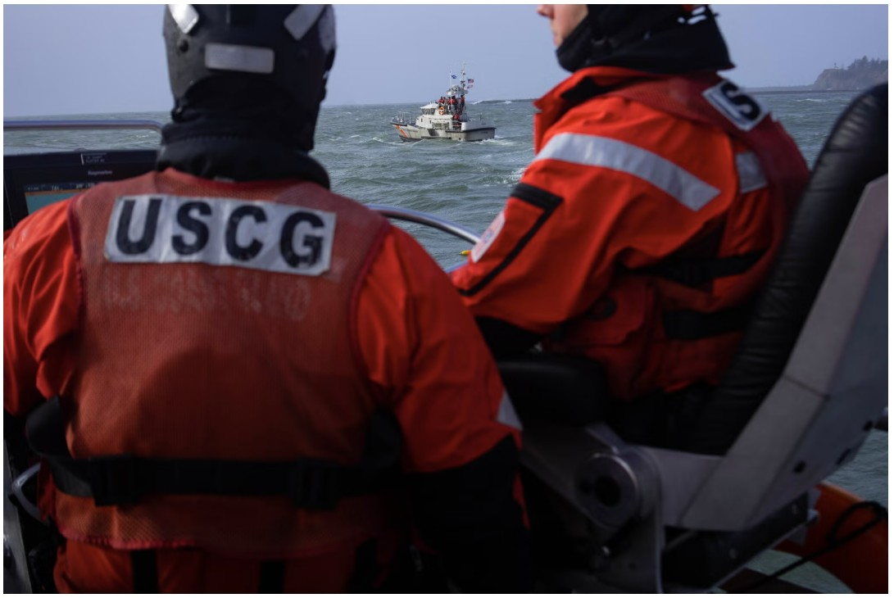

```{=html}
<style>

/* =========================================================
   Typography
   ========================================================= */

body {
  color: #212529;
}


/* =========================================================
   Responsive Mobile Layout
   Stack ALL Quarto columns on narrow screens
   ========================================================= */

@media (max-width: 768px) {

  .columns {
    display: block !important;
  }

  .columns > .column {
    width: 100% !important;
    max-width: 100% !important;
    flex: 0 0 100% !important;
  }

  .columns > .column:empty {
    display: none !important;
  }

  img {
    max-width: 100%;
    height: auto;
  }

  p,
  li,
  figcaption {
    overflow-wrap: anywhere;
  }

}


/* =========================================================
   Poll Everywhere Layout
   Keep questions left and QR code right
   ========================================================= */

@media (min-width: 769px) {

  .poll-columns {
    display: flex !important;
    align-items: flex-start !important;
    gap: 24px;
  }

  .poll-columns > .column {
    flex: initial !important;
  }

}


/* =========================================================
   Historical Timeline
   ========================================================= */

.history-timeline {
  display: flex;
  overflow-x: auto;
  gap: 0;
  padding: 38px 0 20px;
  margin: 20px 0;
}

.history-event {
  flex: 1 0 115px;
  min-width: 115px;
  text-align: center;
  position: relative;
  border-top: 3px solid #8495a5;
  padding: 22px 7px 0;
}

.history-event::before {
  content: "";
  position: absolute;
  top: -8px;
  left: calc(50% - 7px);
  width: 14px;
  height: 14px;
  border-radius: 50%;
  background: #8495a5;
}

.history-event.current {
  border-top-color: #b46c36;
}

.history-event.current::before {
  background: #b46c36;
}

.history-lecture {
  font-size: 0.78rem;
  font-weight: 700;
  color: #566b7d;
}

.history-name {
  font-weight: 700;
  font-size: 0.92rem;
  margin-top: 7px;
}

.history-date {
  font-size: 0.78rem;
  color: #606b74;
}

.history-current-label {
  position: absolute;
  top: -39px;
  left: 0;
  right: 0;
  color: #a55a22;
  font-weight: 800;
  font-size: 0.82rem;
}

@media print {

  .history-timeline {
    overflow: visible;
  }

  .history-event {
    flex: 1 1 0;
    min-width: 0;
    padding-left: 3px;
    padding-right: 3px;
  }

  .history-name {
    font-size: 0.72rem;
  }

  .history-date {
    font-size: 0.65rem;
  }

}


/* =========================================================
   Featured Question Section
   ========================================================= */

.question-highlight {
  background-color: #343a40;
  color: #ffffff;
  padding: 32px 38px;
  border-radius: 12px;
  margin: 28px 0;
  border-left: 6px solid #f4c542;
}

.question-highlight h1,
.question-highlight h2,
.question-highlight h3 {
  color: #f4c542 !important;
}

.question-highlight p,
.question-highlight p strong {
  color: #ffffff !important;
}

@media (max-width: 768px) {

  .question-highlight {
    padding: 22px 20px;
  }

}


/* =========================================================
   Smallpox Timeline
   ========================================================= */

.smallpox-timeline {
  border-left: 3px solid #8495a5;
  margin: 28px 0 28px 16px;
  padding-left: 26px;
}

.smallpox-milestone {
  position: relative;
  margin-bottom: 23px;
}

.smallpox-milestone::before {
  content: "";
  position: absolute;
  left: -35px;
  top: 5px;
  width: 13px;
  height: 13px;
  border-radius: 50%;
  background: #8495a5;
  border: 3px solid white;
}

.smallpox-century {
  font-weight: 800;
  color: #9a552b;
  margin-bottom: 5px;
}

.smallpox-description {
  color: #212529;
  line-height: 1.55;
}

@media (max-width: 768px) {

  .smallpox-timeline {
    margin-left: 9px;
    padding-left: 20px;
  }

  .smallpox-milestone::before {
    left: -29px;
  }

}


/* =========================================================
   Align Historical Section Headings with Images
   ========================================================= */

.ancient-egypt-layout {
  align-items: flex-start !important;
}

.ancient-egypt-layout .history-text-column h3:first-of-type {
  margin-top: 0 !important;
  margin-block-start: 0 !important;
  padding-top: 0 !important;
}

.ancient-egypt-layout .history-text-column {
  padding-top: 0 !important;
}


/* Equal-height cowpox images */

img.cowpox-equal-height {
  width: 100%;
  height: 280px;
  object-fit: contain;
}


/* =========================================================
   Guest Lecture: Red Content Warning Callout
   ========================================================= */

.callout.callout-warning {
  border-color: #b42318 !important;
  border-left: 5px solid #b42318 !important;
}

.callout.callout-warning > .callout-header {
  background-color: #fce8e6 !important;
  color: #8f2118 !important;
}

.callout.callout-warning .callout-title {
  color: #8f2118 !important;
}

.callout.callout-warning .callout-icon::before {
  color: #b42318 !important;
}


/* =========================================================
   Guest Lecture: Embedded Video
   ========================================================= */

.lecture-video {
  max-width: 900px;
  margin: 24px auto;
}

.lecture-video video {
  width: 100%;
  height: auto;
  border-radius: 8px;
  background-color: #000000;
}

.video-caption {
  font-size: 0.85rem;
  color: #606b74;
  margin-top: 8px;
  line-height: 1.5;
}


/* =========================================================
   Poll Everywhere QR Image
   ========================================================= */

.poll-qr img {
  width: 100%;
  max-width: 260px;
  height: auto;
  display: block;
  margin: 0 auto;
}

.poll-qr {
  text-align: center;
}

</style>
```

:::::: columns
::: {.column width="40%"}
{fig-alt="U.S. Coast Guard rescue boat operating in coastal waters near Cape Disappointment, Washington" width="100%"}
:::

::: {.column width="4%"}
:::

::: {.column width="56%"}
## SHM 102: Occupational Health

### Feature Lecture: New York Times: Occupational Brain Injuries and Mental Health

**Guest Lecture · Fall 2026**

Yoni Rodriguez\
Engineering Technologies, Safety, and Construction\
Central Washington University\
[Yoni.Rodriguez\@cwu.edu](mailto:Yoni.Rodriguez@cwu.edu)
:::
::::::

------------------------------------------------------------------------

::: {.callout-warning appearance="default" icon="true"}
## Content Warning: Suicide and Mental Health

This feature lecture discusses suicide, psychological distress, post-traumatic stress disorder (PTSD), and possible traumatic brain injuries.

The accompanying reporting includes the experience of a U.S. Coast Guard veteran who died by suicide and the effects of his death on his family.

We will focus on occupational exposures, injury recognition, and prevention rather than graphic details.

**Alternative Participation: Background Reading**

Students who would prefer not to watch or listen to the accompanying reporting, or participate in the classroom discussion, may instead review the following articles independently:

1.  [Rescue Boat Crews Show Signs of Brain Injuries, but Coast Guard Isn't Looking (July 30, 2026)](https://www.nytimes.com/2026/07/30/us/coast-guard-rescue-boat-surfmen-brain-injury.html?smid=nytcore-ios-share)

2.  [Coast Guard Vows to Protect Crews From Brain Injuries Caused by Rough Seas (July 31, 2026)](https://www.nytimes.com/2026/07/31/us/31nat-coast-guard-brain-injury-boat-waves-surfmen.html?smid=nytcore-ios-share)

These articles cover the same occupational health concerns discussed in the lecture and allow students to engage with the material at their own pace. **Please be aware that the first article also discusses suicide and mental health.**

Students may step out during the video or discussion if needed. Please speak with Professor Rodriguez if you would like to arrange an alternative way to participate or demonstrate your understanding of the material.
:::

# Guest Lecture: Featured Media

The following reporting from *The New York Times* examines potential occupational brain injuries among U.S. Coast Guard rescue boat crews and the challenges of recognizing neurological symptoms that may overlap with mental health conditions.

## YouTube: Coast Guard Brain Injury Investigation

```{=html}
<div style="max-width: 900px; margin: 24px auto;">
  <div style="position: relative; padding-bottom: 56.25%; height: 0; overflow: hidden; border-radius: 10px;">
    <iframe
      src="https://www.youtube.com/embed/zZD-cGFIls8?start=1"
      title="Coast Guard Brain Injury Investigation"
      style="position: absolute; top: 0; left: 0; width: 100%; height: 100%; border: 0;"
      allow="accelerometer; autoplay; clipboard-write; encrypted-media; gyroscope; picture-in-picture; web-share"
      referrerpolicy="strict-origin-when-cross-origin"
      allowfullscreen>
    </iframe>
  </div>
</div>
```

**Alternative viewing and listening options:**

- [Watch directly on YouTube](https://www.youtube.com/watch?v=zZD-cGFIls8&t=1s)
- [Listen to The Daily Podcast (September 1, 2026)](https://www.nytimes.com/2026/09/01/podcasts/the-daily/brain-injuries-coast-guard.html?rref=vanity)

# Introduction: Occupational Brain Injuries

Occupational health examines how working conditions, environmental exposures, and workplace hazards influence the health and well-being of workers.

Some occupational injuries are immediately recognizable, such as fractures, burns, or injuries caused by falling objects.

Other injuries may develop gradually through repeated exposures and remain undiagnosed for years.

One emerging concern involves **repetitive mechanical impacts and their potential effects on the brain**, even when workers do not experience an obvious head injury.

This guest lecture examines that concern through the experiences of U.S. Coast Guard rescue boat crews.

::: {.callout-note appearance="default" icon="true"}
## Central Question

Can repeated occupational exposures cause neurological injuries that are mistaken for psychological stress or mental health conditions?
:::

# [The Occupational Hazard: Coast Guard Surfmen](https://www.nytimes.com/2026/07/30/us/coast-guard-rescue-boat-surfmen-brain-injury.html)

The United States Coast Guard operates rescue boats in some of the most dangerous maritime environments in the country.

Among its highly trained personnel are **surfmen**, who operate specialized rescue boats through large breaking waves to reach people in distress.

These crews frequently operate 47-foot motor lifeboats designed to withstand extreme maritime conditions.

Although the boats are designed to protect their occupants from immediate hazards, the crews may experience thousands of forceful impacts as the boats repeatedly strike waves and drop into troughs.

These impacts can cause rapid acceleration, deceleration, and movement of the head and neck.

Importantly, a worker does not necessarily need to strike their head against a hard surface to experience potentially harmful forces.

## Coast Guard Training: Oregon Coast

```{=html}
<div class="lecture-video">

<video controls preload="metadata">
  <source src="u.s.-coastguard-training-off-the-coast-of-orgeon-sharon-biddinger.mp4" type="video/mp4">
  Your browser does not support embedded video playback.
</video>

<div class="video-caption">
<strong>Video:</strong> U.S. Coast Guard training off the coast of Oregon.<br>
<strong>Credit:</strong> Sharon Biddinger.
</div>

</div>
```

**While watching the video, consider:**

- What physical hazards are present during these rescue operations?
- How might repeated wave impacts affect the crew?
- What types of injuries might not be immediately apparent?

# [The Investigation: Recognizing a Hidden Occupational Injury](https://www.nytimes.com/2026/07/30/us/coast-guard-rescue-boat-surfmen-brain-injury.html)

On July 30, 2026, *The New York Times* published an investigation by journalist Dave Philipps examining possible brain injuries among Coast Guard rescue boat crews.

The reporting centered on the experience of **Brett Bonner**, a Coast Guard veteran who spent approximately 21 years operating rescue boats.

During his career, Bonner experienced repeated exposure to rough seas and forceful wave impacts.

Over time, his family observed changes in his memory, sleep, behavior, and emotional well-being.

He received mental health diagnoses and treatment, but the possibility that repeated occupational impacts contributed to neurological injury was not initially recognized.

Bonner died by suicide in February 2025.

His experience raises an important occupational health question: **What happens when workers develop symptoms that may have more than one underlying cause?**

The reporting does not establish that occupational brain injury caused his death. Rather, it highlights the importance of investigating possible physical and psychological contributors to changes in worker health.

## Kayleigh Bonner's Research

Following her father's death, Brett Bonner's daughter, **Kayleigh Bonner**, began investigating whether other Coast Guard surfmen experienced similar symptoms.

For a high school research project, she developed a questionnaire examining occupational history and health symptoms among active and retired surfmen.

**Seventy-seven surfmen responded to the survey.**

Many reported symptoms including:

- Headaches and migraines
- Memory difficulties
- Cognitive problems
- Sleep disturbances
- Anxiety and panic attacks
- Mood changes and irritability

The findings suggested that these symptoms were not limited to one individual.

However, the survey was exploratory. Self-reported symptoms do not establish a diagnosis of traumatic brain injury, and the survey cannot determine how frequently these injuries occur among all surfmen.

Nevertheless, the findings identified an occupational health concern that warranted further investigation.

# Understanding Traumatic Brain Injury

A **traumatic brain injury (TBI)** is an injury involving disruption of normal brain function caused by an external mechanical force.

Such forces may involve:

- Direct impacts to the head
- Rapid acceleration or deceleration
- Rotational movement of the head
- Blast-related pressure waves

A concussion is one form of traumatic brain injury.

However, the absence of an obvious concussion does not necessarily eliminate concern about repeated mechanical exposure.

The Coast Guard investigation raises questions about whether repeated wave impacts may produce neurological effects that accumulate over years of service.

The relationship between specific exposure levels, repeated impacts, and long-term neurological outcomes among Coast Guard surfmen requires additional research.

## Physical Injuries and Mental Health

One challenge in recognizing brain injuries is that neurological and psychological conditions can produce overlapping symptoms.

| Reported symptom | Possible neurological or psychological relevance |
|------------------------------------|------------------------------------|
| Headaches | May occur following brain injury or with other medical conditions |
| Memory difficulties | May involve cognitive dysfunction, stress, or other causes |
| Sleep disturbances | Common in both neurological and mental health conditions |
| Anxiety | May occur independently or alongside neurological injury |
| Irritability and mood changes | Can have multiple neurological and psychological contributors |
| Difficulty concentrating | May occur with TBI, PTSD, depression, or other conditions |

These symptoms alone cannot establish a diagnosis.

**Traumatic brain injury and PTSD are not mutually exclusive.** A worker may experience both physical injury and psychological trauma.

For occupational health professionals, this emphasizes the importance of considering the complete exposure history rather than assuming that symptoms have only one explanation.

# [Occupational Health Surveillance: What Was Missing?](https://www.nytimes.com/2026/07/30/us/coast-guard-rescue-boat-surfmen-brain-injury.html)

The *New York Times* investigation reported that the Coast Guard had not systematically studied the potential neurological consequences of repeated wave impacts among its surfmen.

This presented several occupational health challenges.

**1. Exposure characterization**

How many impacts does a worker experience during training and rescue operations? What are the magnitudes and frequencies of those impacts?

**2. Health surveillance**

Are workers routinely evaluated for symptoms that may indicate neurological injury?

**3. Injury recognition**

Do workers and medical providers understand that repeated wave impacts may represent a potential brain injury hazard?

**4. Reporting and organizational culture**

Are workers comfortable reporting symptoms that could affect their ability to continue performing rescue operations?

**5. Prevention**

What engineering, operational, or administrative interventions could reduce exposure while maintaining rescue capabilities?

# [Coast Guard Response: July 31, 2026](https://www.nytimes.com/2026/07/31/us/31nat-coast-guard-brain-injury-boat-waves-surfmen.html)

On July 31, 2026, *The New York Times* reported that the U.S. Coast Guard had announced plans to address possible brain injuries associated with repeated wave impacts.

Admiral Kevin Lunday, Commandant of the Coast Guard, acknowledged the concern and announced a broader brain health initiative.

The proposed response included:

- Training personnel to recognize potential brain injury symptoms
- Encouraging workers to report symptoms
- Improving medical monitoring and treatment protocols
- Collaborating with civilian medical experts and other military branches
- Measuring wave impacts using sensors aboard rescue boats

The Coast Guard had also begun working with researchers to collect impact measurements from small boats.

These efforts may help characterize the magnitude and frequency of occupational exposures and inform future prevention strategies.

The announcement represents an organizational response to an identified occupational health concern. It does not, by itself, establish that the proposed measures have been fully implemented or proven effective.

# Applying Occupational Health Principles

The Coast Guard case provides an opportunity to apply several concepts introduced in SHM-102.

| Occupational health concept | Coast Guard case study |
|------------------------------------|------------------------------------|
| Hazard identification | Repeated mechanical impacts from rough seas |
| Exposure assessment | Measuring acceleration and impact forces aboard rescue boats |
| Health effects | Reported neurological, cognitive, and psychological symptoms |
| Surveillance | Monitoring workers for potential brain injury symptoms |
| Risk communication | Educating crews about potential occupational hazards |
| Prevention | Reducing harmful exposures and improving early recognition |
| Worker health protection | Ensuring access to appropriate medical evaluation and care |

The case also demonstrates why occupational health investigations often require collaboration among engineers, exposure scientists, physicians, epidemiologists, psychologists, and workers themselves.

# Poll Everywhere: Occupational Brain Injuries

The following questions connect the Coast Guard investigation to occupational hazard recognition, exposure assessment, neurological health, and injury prevention.

Please scan the QR code to submit your responses using **Poll Everywhere**. We will discuss the responses together as a class.

:::::: {.columns .poll-columns}
::: {.column width="70%"}
### Questions

**1. Occupational Exposure and Worker Health**

When workers report changes in memory, behavior, mood, or mental health, how should occupational health professionals determine whether workplace exposures may be contributing to those symptoms?

**2. Hazard Recognition**

Why might repeated wave impacts be overlooked as a potential occupational brain injury hazard?

**3. Exposure Assessment**

What measurements would help researchers determine whether surfmen experience potentially harmful mechanical forces?

**4. Mental Health and Neurological Injury**

Why is it important to consider both psychological stress and possible neurological injury when evaluating workers?

**5. Organizational Responsibility**

What responsibilities do employers have when emerging evidence suggests that routine job duties may contribute to long-term health problems?

**6. Occupational Injury Prevention**

How could the Coast Guard reduce potential neurological risks without compromising its ability to perform rescue missions?
:::

:::: {.column width="30%"}
::: poll-qr
{fig-alt="Poll Everywhere QR code for submitting class responses" width="100%"}

**Scan to participate**
:::
::::
::::::

# Closing Perspective

The experience of Coast Guard surfmen illustrates a fundamental principle of occupational health:

**Not all occupational injuries are immediately visible, and not all occupational hazards are recognized when workers first begin experiencing symptoms.**

Repeated exposures may produce health concerns that are difficult to identify, especially when symptoms overlap with psychological stress, aging, or other medical conditions.

The Coast Guard investigation also demonstrates how observations from workers and families can generate research questions, encourage exposure assessment, and influence organizational responses.

For occupational health professionals, the goal is not simply to respond after injuries occur.

It is to recognize potential hazards, investigate exposures, identify health effects, and develop interventions that protect workers throughout their careers.

------------------------------------------------------------------------

## Copyright and Third-Party Materials {.unnumbered}

© 2026 Yoni Rodriguez. All rights reserved.

Original lecture text, instructional organization, and teaching materials were prepared by Yoni Rodriguez for SHM 102: Occupational Health at Central Washington University.

**Third-party materials:** Articles, photographs, audio, video, and other materials produced by *The New York Times* remain the intellectual property of The New York Times Company and/or their respective rights holders. These materials are not covered by the copyright notice above.

The U.S. Coast Guard training video credited to Sharon Biddinger is likewise acknowledged as third-party material and is not covered by the instructor's copyright.

Third-party materials are included or linked for educational purposes. All rights remain with their respective copyright holders. Inclusion does not imply ownership, endorsement, or permission for redistribution.
